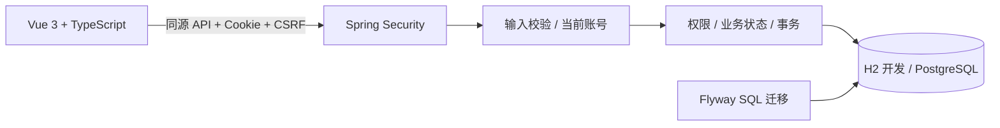
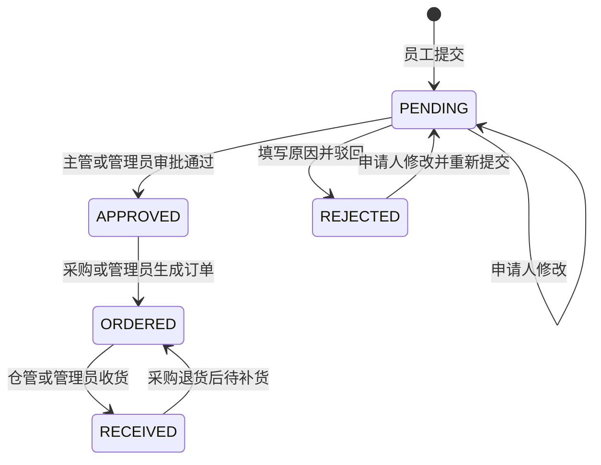
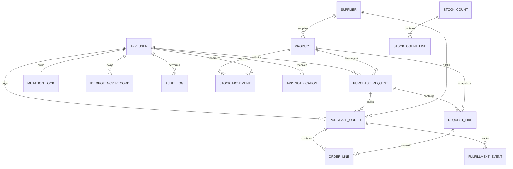

# 业务与工程设计

## 请求链路

开发时 Vite 代理 `/api` 到 8080，避免跨域配置。容器中 Nginx 同源代理到后端。认证使用 Spring Security 标准表单登录和会话固定攻击防护，Cookie 为 HttpOnly / SameSite=Lax；CSRF 默认启用。前端每次登录/退出后重新获取 token，写请求携带 `X-CSRF-TOKEN`。

## 状态机

状态转换全部由服务端检查。审批使用带原状态条件的更新，只有一个并发操作能够成功。管理员也不能审批自己的申请。主管必须与申请人的部门完全一致。

申请保存提交时的价格快照，订单金额使用快照，不随商品参考价变化。商品资料支持参考价修改；申请人主动修改自己的待审批或驳回申请时，按当前商品价重新建立快照，界面会提示重新计价。申请版本在编辑和审批后递增，审批必须携带看到的版本，防止批准已被修改的内容。

## 编辑与账号状态

商品、供应商和采购申请都携带 version，提交旧版本返回 409。商品资料编辑不写 stock；已有采购或流水时，不允许变更计量单位，避免历史数量含义发生变化。

成员支持 enabled 和 version。登录主体保存该次登录的版本，每个受保护 API 都重新核对数据库状态；停用或版本变化会使该请求返回 401 并注销会话。因此，停用后再启用，也无法恢复之前未发过请求的旧会话。成员角色与部门调整后必须重新登录。

管理员变更由独立 administration_lock 行串行化，避免并发操作移除最后一位启用管理员；同时禁止停用自己或移除自己的管理员角色。

## 库存与事务

收货在一个事务中完成：

1. 锁定订单行，检查是否已收货。
2. 增加商品库存，读取新结存。
3. 写入正向库存流水。
4. 更新订单、申请状态，写审计。

重复收货直接返回成功。订单行锁确保两个并发确认只会执行一次库存增加。

领用在一个事务中完成：

1. 锁定当前账号的 `mutation_lock` 行，检查幂等标识与内容指纹。
2. 执行 `UPDATE product SET stock=stock-? WHERE id=? AND stock>=?`。
3. 条件不满足返回 409，事务回滚；满足条件则记录负向流水与结存。
4. 写审计后一起提交。

商品条件更新由数据库保证原子性。商品和流水共享同一事务，失败不会遗留幂等占位或半笔业务数据。账号序列化锁使用独立表，避免锁住用户行后与审计外键检查发生锁顺序冲突。

## 幂等语义

- 创建申请与领用：客户端生成 UUID 放入 `Idempotency-Key`，同一账号同一操作同一 key 返回同一业务结果。
- key 相同但请求内容不同，返回 409；幂等 key 不允许被复用成另一笔操作。
- 创建订单：锁定申请，`purchase_order.request_id` 唯一，重复点击返回原订单。
- 确认入库：锁定订单，已收货时不再修改库存。
- 幂等记录当前长期保存，生产规模下应设计保留期限和归档策略。

## 数据关系

订单兼容字段 status 为 OPEN / RECEIVED，详细 fulfillment_status 为 OPEN / PARTIAL / RECEIVED / RETURNED。净收货 = 累计收货 − 累计退货，待补货 = 采购数量 − 净收货。退货重新打开待补货数量；每次变化与流水、明细数量、订单状态、申请总状态在同一事务中提交。

同一申请的不同供应商订单收货共用申请行锁，防止并发收货时申请总状态错误；商品按 ID 顺序锁定。流水数量为带符号变动数，balance 保存该次变动后的结存。库存版本 stock_version 随库存变化递增，用于拒绝基于旧账面数提交的盘点。

## 业务边界与后续演进

当前是单组织、单仓库、多商品明细和单级审批。进一步对标生产项目时，可以依次引入：

1. 采购关闭/取消、退款与财务冲销。
2. 组织实体与角色配置，替代目前按部门名称比对。
3. 服务端分页、查询条件和数据量验证。
4. 多级审批、通知的邮件/企业聊天集成，按实际需要加入 outbox 与异步处理。
5. 多租户隔离、统一身份与集中会话，扩容后完善监控、恢复演练和发布策略。

新功能已按明细、收退货、盘点归还、个人中心、通知和备份分离组件与服务。仍为单体应用，不存在跨服务事务。旧版请求和订单头字段用于兼容单商品 API，新的金额与数量从明细计算，不能把兼容头字段当成完整单据。
